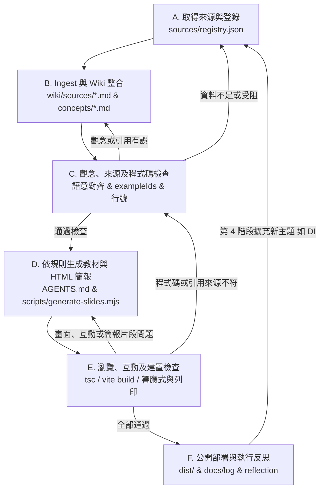
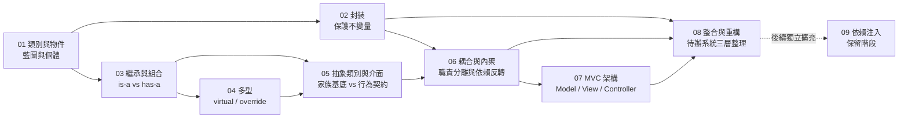

# 開發與知識處理工作流程（Workflow & Graph）

本專案嚴格區分兩種結構圖，避免把「內容製作與查核順序」和「教學概念知識脈絡」混為一談：
1. **工作流程圖（Workflow Graph，本文件核心）**：描述來源查核、教材生成、簡報同步、程式檢查、退回修正回路與公開部署的工程作業流程。
2. **概念知識關聯圖（Concept Knowledge Map，學習輔助）**：描述第 01 至 08 章程式設計觀念之間的先修與延伸關係。

---

## 一、工作流程圖（A–F 階段與退回修正回路）

---

## 二、A–F 各節點規格說明（輸入／產出／通過條件／失敗退回／設計理由）

### 節點 A：取得來源與登錄
- **輸入**：候選官方文件 URL（如 Microsoft Learn C#／MVC 文件）、補充文章與 `AGENTS.md` 來源規範。
- **產出**：`sources/registry.json` 登錄條目（含穩定 `src-*` ID、對應章節、初始狀態 `pending` 或實測受阻 `unavailable`）。
- **通過條件**：每筆外部參考資料都有唯一 `src-*` ID 與原始 URL；**尚未取得完整正文前，`readDate` 嚴格維持 `null`**。
- **失敗時的下一步**：若目標網頁遭防爬機制（如 Medium HTTP 403）或權限阻擋，將狀態改為 `unavailable` 並記明原因，同時搜尋或更換可實地存取之官方來源，禁止以搜尋摘要充數。
- **設計理由**：將「發現網址」與「實際讀懂內容」拆開，避免後續撰寫教材時把還沒讀過的文章誤當成已驗證依據。

### 節點 B：Ingest 與 Wiki 整合
- **輸入**：從節點 A 實地取得之來源正文內容。
- **產出**：`wiki/sources/<source-id>.md` 閱讀筆記（含摘要、核心觀念、適用範圍與限制）、`sources/registry.json` 更新為 `ingested` 並填入實際 `readDate`，以及整合後的 `wiki/concepts/*.md`。
- **通過條件**：筆記以自己的話整理並區分來源界線；教材確實整合對應觀念且僅於 `sourceIds` 引用 `ingested` 條目；局部尚待補充來源處明確標註「待驗證」。
- **失敗時的下一步**：若發現手邊來源不足以解釋核心語意（例如 MVC 與渲染層級定義不夠清楚），**退回節點 A** 補登錄並讀取其他官方文件。
- **設計理由**：實踐 LLM Wiki「Raw Source → Source Note → Concept Article」三層累積，避免直接複製貼上原文或產生無根據敘述。

### 節點 C：觀念、來源及程式碼檢查
- **輸入**：`wiki/concepts/*.md`、`wiki/sources/*.md`、`examples/csharp/<chapter>/*.cs` 與 `src/domain/*.ts`。
- **產出**：一致性檢查通過清單，包含 `compileStatus` 誠實狀態、`scopeKind` 專案範圍標記、互動高亮行號與 `slideLineRange` 對齊確認。
- **通過條件**：
  1. 教材符合九大固定標題與 Frontmatter 必填欄位；
  2. C# 語意與現代語言規範相符（如 C# 介面可含預設實作但無實例欄位／建構式），無本地 `.NET SDK` 時維持 `unverified-no-dotnet`；
  3. 互動模擬之 `highlightLines` 與簡報 `slideLineRange` 皆對應到真實程式碼行數。
- **失敗時的下一步**：
  - 資料來源依據不足 → **退回節點 A**；
  - 觀念說明或來源引用有誤 → **退回節點 B** 修訂筆記與教材段落；
  - 程式碼與行號對齊錯誤 → 直接修正對應 `.cs` 或 `.ts` 後重測節點 C。
- **設計理由**：把容易發生的觀念誤用與行號錯位在進入頁面整合前攔截，減少後期視覺驗收才返工的成本。

### 節點 D：依規則生成教材與 HTML 簡報
- **輸入**：已通過節點 C 的 `wiki/concepts/*.md`、`examples/csharp/` 與 `AGENTS.md`（第 4.4、6.3 節簡報同步規則）。
- **產出**：網站教材知識庫頁、內建簡報檢視器（`#/slides`）及同步產出之獨立 HTML 教學簡報（`public/slides.html`，共 21 頁）。
- **通過條件**：簡報與教材共用完全相同的主題 ID、摘要、範例 ID 與來源 ID；每頁維持單一重點，無另外編寫的矛盾版本；支援鍵盤翻頁防護、全螢幕替代模式與列印分頁展開。
- **失敗時的下一步**：若簡報片段過長、行號切片錯誤或內容偏離教材，**退回節點 C** 重新調整 `slideLineRange` 或節點 D 的抽取規則後重新執行 `npm run build:slides`。
- **設計理由**：以「單一資料來源（Single Source of Truth）」確保教材與簡報永遠一致，未來修改教材時不需手動同步兩邊程式碼。

### 節點 E：瀏覽、互動及建置檢查
- **輸入**：全部前端程式（`src/`）、Wiki 內容、獨立 HTML 簡報與 `vite.config.ts`。
- **產出**：`npm run lint`（`tsc --noEmit`）、`npm run build`（含 `generate-slides.mjs` 與 `vite build` 產出 `dist/`）、自動化一致性檢查腳本輸出與跨裝置版面檢查。
- **通過條件**：零 TypeScript 型別錯誤；靜態建置通過且 `dist/index.html` 使用 `./` 相對路徑與 `HashRouter`；桌面與手機寬度無水平溢出；剪貼簿與全螢幕受限時備援機制可正常運作；列印版面可完整展開全部投影片。
- **失敗時的下一步**：
  - 互動元件、鍵盤操作、列印樣式或響應式畫面異常 → **退回節點 D**（或對應 `src/components/`、`src/interactive/` 製作節點）修正；
  - 內容解析或來源引用失敗 → **退回節點 C**。
- **設計理由**：在真正部署到公開網頁前，透過自動化靜態建置與瀏覽檢視確保零破圖、零斷鏈。

### 節點 F：公開部署與執行反思
- **輸入**：通過節點 E 之 `dist/` 建置產物、真實命令執行結果與過程觀察。
- **產出**：更新後的 `wiki/log.md`、`docs/process-log.md`、`docs/verification.md`、`docs/reflection.md`、更新後之 `docs/submission-guide.md`，以及可公開瀏覽之 GitHub Repository 與 GitHub Pages 網址。
- **通過條件**：紀錄文件只包含真實執行日誌與已觀察之限制（未執行項目明確標為待執行）；公開網址可正常瀏覽教材、互動模擬、HTML 簡報與流程頁。
- **失敗／擴充時的下一步**：
  - 若公開子路徑載入資源失敗（404）→ **退回節點 E** 檢查 `base: './'`、`HashRouter` 與 `public/slides.html` 相對連結；
  - 若要進行第 4 階段擴充實驗（例如新增第 09 章「依賴注入」）→ **從節點 F 回到節點 A** 完整重走一次閉環。
- **設計理由**：將「部署與誠實反思」納入工作流程最後一環並接回起點，驗證規範文件能否支撐未來的真實擴充。

---

## 三、學習輔助圖：教學概念知識關聯圖（與工作流程圖區分）

> **注意**：下圖僅說明「課程內容 01–08 章的程式觀念先修與進階順序」，與上方「A–F 開發與查核工作流程」屬完全不同層次的圖表。

